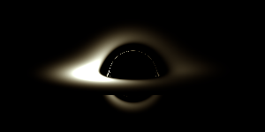
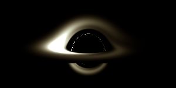
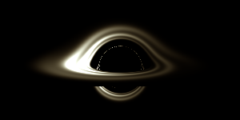

# BlackHole 512

A black hole renderer in 512 bytes of HTML and JavaScript.

**[Open it](https://kierancschmitt.github.io/BlackHole512/program/blackhole-preview.html)** · [Video](https://kierancschmitt.github.io/BlackHole512/media/demo.mp4) · [Code](program/blackhole-512.html)

[](https://kierancschmitt.github.io/BlackHole512/media/demo.mp4)

## Run it

Download [blackhole-preview.html](program/blackhole-preview.html) and open it in a browser. No setup or dependencies. Give it a moment to calculate the light paths.

The preview has pause, restart and playback speed controls. Restart keeps the speed and paused state. Reduced motion starts it paused.

[blackhole-512.html](program/blackhole-512.html) is the whole 512-byte program, HTML included. The preview adds comments and controls outside that limit. Both render at 300 × 150.

## How it works

It traces 45,000 rays around a nonrotating black hole. The camera stays put, so the light paths only need to be calculated once. Each frame updates the disk's emission using those cached paths.

The disk pattern rotates and moves inward. Light bending, gravitational and Doppler shifts, and travel-time delays affect what you see. Three samples of a thermal spectrum give the color.

A few things share the same math to save bytes: the radius terms feed both motion and temperature, and the photon-clock increment is reused for the radial Doppler shift. The compact version caches a shading function for each pixel.

## Screenshots

<p>
  
  
</p>

## Size

```sh
wc -c program/blackhole-512.html
```

512 bytes. No build step. A trailing newline counts too.

## Limits

The disk motion is prescribed, not a fluid simulation. The disk has no thickness, the color is approximate, and small details can alias at this resolution. The pattern keeps winding up; it doesn't generate new turbulence.

Playback isn't calibrated to a particular black hole mass. The compact version's speed depends on your device; the preview uses a clock.

Created by Kieran Schmitt.
